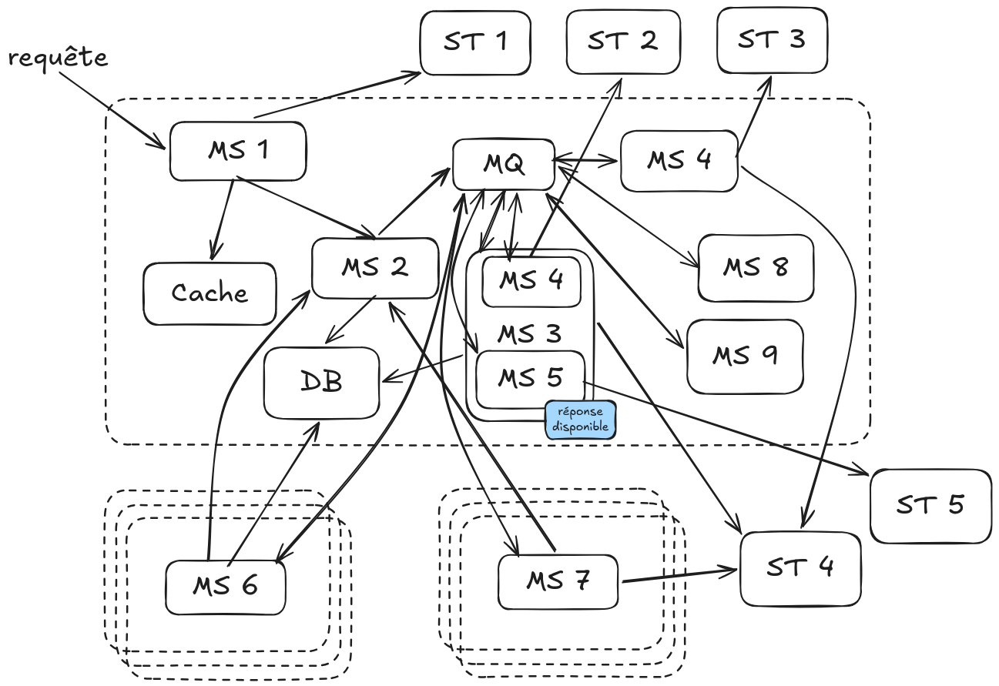
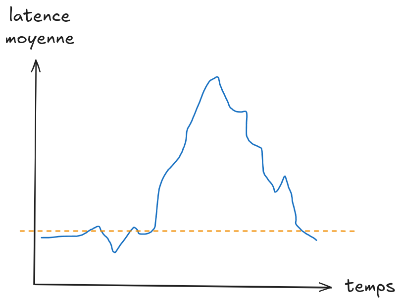
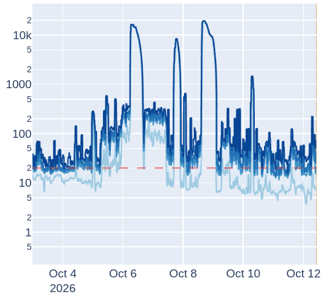
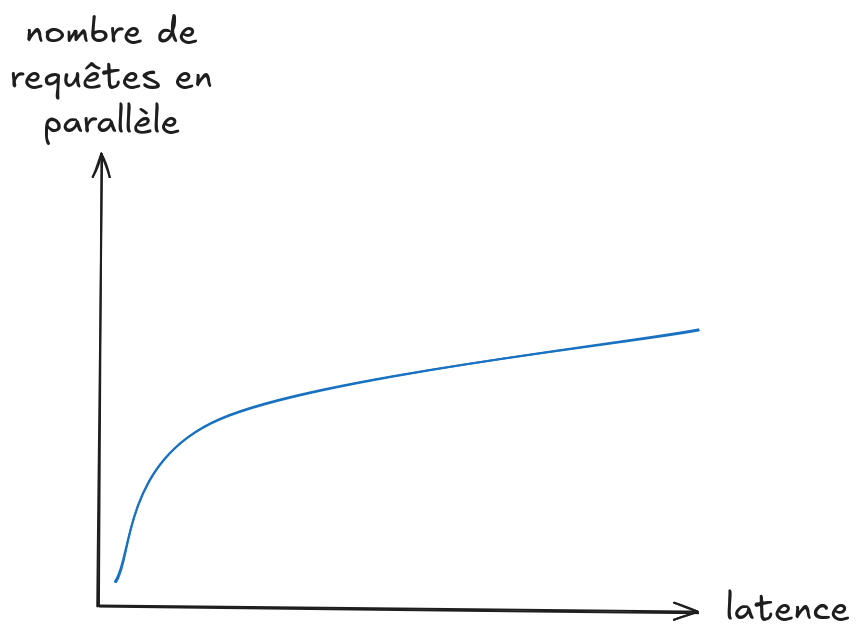
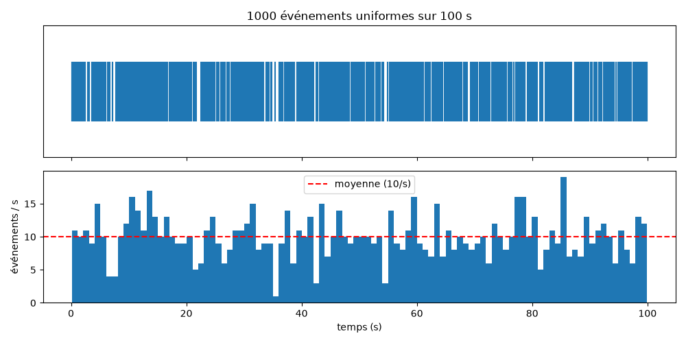
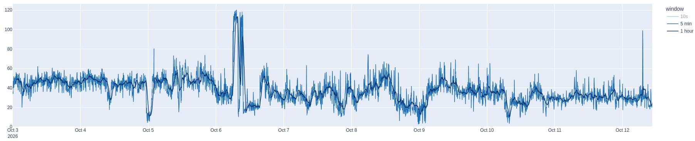
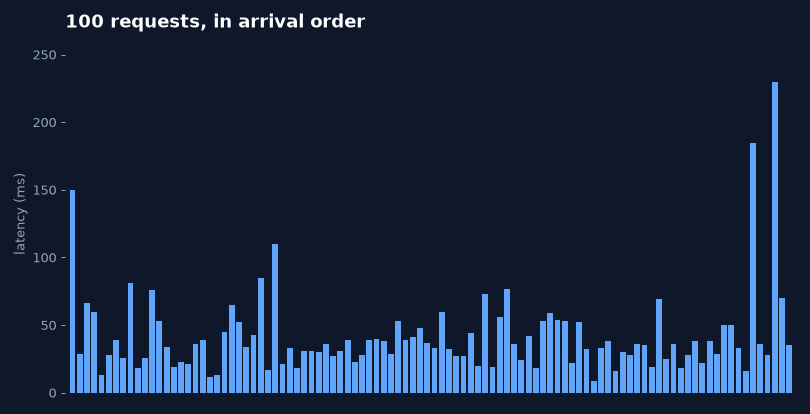
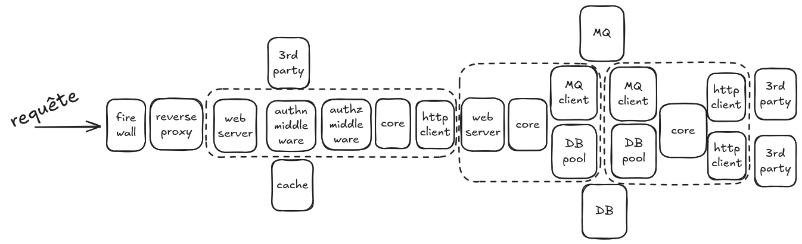
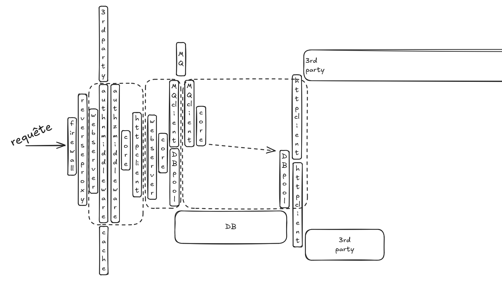
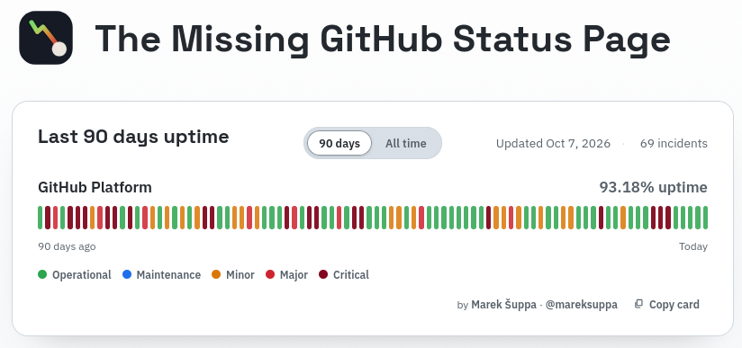

<style>
.reveal section[data-background-image] h1:not(:empty) {
  background: rgba(0, 0, 0, 0.6);
  padding: 20px 40px;
  border-radius: 10px;
  display: inline-block;
  color: AliceBlue;
}
</style>

# P99, et au-delà

-v-

## Présentation

Julien Lenormand


---

# Le problème : un pipeline lent


-v-



-v-



-v-

  <!-- .element: width="1200px" -->

-v-



---

# Définir le problème

> On ne peut pas résoudre un problème si on ne le décrit pas correctement.
> - Jean-Marc Jancovici

-v-

Besoin :
> Quand un utilisateur soumet une requête, il a le résultat "rapidement".

Traduction :<!-- .element: class="fragment" data-fragment-index="1" -->
> le délai entre l'entrée de la requête dans le système, et la mise à disposition du résultat, ne doit pas être supérieur à X secondes.
<!-- .element: class="fragment" data-fragment-index="1" -->

Choisir X.  <!-- .element: class="fragment" data-fragment-index="2" -->

-v-

## Les méchantes mathématiques : Poisson

```python
import numpy as np

rng = np.random.default_rng(42)
t = np.sort(rng.uniform(0, 100, 1000))
```



-v-

## Le méchant monde réel



avg: 37.4  |  median: 33.0  |  p90: 62  |  p95: 73  |  p99: 109

-v-

  <!-- .element: width="1200px" -->

-v-

## La solution

* p95 latency ≤ 20s
* réaliste ?  <!-- .element: class="fragment" --> 
* atteignable ?  <!-- .element: class="fragment" --> 

---

# C'est parti !

Par quoi on commence ?

-v-

# Mesurer, mesurer, mesurer

* <!-- .element: class="fragment" --> Mesurer
* <!-- .element: class="fragment" --> Mesurer
* <!-- .element: class="fragment" --> Mesurer, encore
* <!-- .element: class="fragment" --> **ME**
* <!-- .element: class="fragment" --> **SU**
* <!-- .element: class="fragment" --> **RER !!!!**
* <!-- .element: class="fragment" --> MESURER  <!-- .element: style="font-size:4em"; -->

-v-

## Quoi/comment mesurer ?

  <!-- .element: width="1200px" -->

* <!-- .element: class="fragment" --> framework, monitoring, observability (OTel)
* <!-- .element: class="fragment" --> timestamps en DB

-v-

  <!-- .element: width="1600px" -->

---

# Solutions

* <!-- .element: class="fragment" --> traiter plusieurs requêtes en même temps :
  * <!-- .element: class="fragment" --> multithreading
  * <!-- .element: class="fragment" --> multiprocessing
  * <!-- .element: class="fragment" --> async
  * <!-- .element: class="fragment" --> CPU-bound versus IO-bound
  * <!-- .element: class="fragment" --> scaling horizontal (+ de nodes)
* <!-- .element: class="fragment" --> traiter une requête plus vite :
  * <!-- .element: class="fragment" --> scaling vertical (CPU freq, CPU cores, RAM, GPU, ...)
* <!-- .element: class="fragment" --> traiter plus efficacement une requête :
  * <!-- .element: class="fragment" --> optimisation locale/globale
  * <!-- .element: class="fragment" --> cache (LRU, FIFO, TTL, DB index, ...)
  * <!-- .element: class="fragment" --> trade-off RAM versus CPU
* <!-- .element: class="fragment" --> ne pas traiter certaines requêtes :
  * <!-- .element: class="fragment" --> HTTP 429 Too Many Requests
  * <!-- .element: class="fragment" --> backpropagation
* <!-- .element: class="fragment" --> ...

-v-

# Solutions vaines

* <!-- .element: class="fragment" --> Loi d'Amdahl : rendre 1000x plus rapide 5% du pipeline ne l'accélère que de 4,9999%
* <!-- .element: class="fragment" --> queuing theory : plus les queues sont saturées, plus la latence explose
* <!-- .element: class="fragment" --> low-hanging fruits
* <!-- .element: class="fragment" --> rendements décroissants, coûts exponentiels
* <!-- .element: class="fragment" --> résoudre un bottleneck ne fait que révéler le prochain

-v-

Mise en contexte : availability
* p50 = ~182 jours de downtime par an
* p90 = ~36 jours
* p99 = 3,6 jours
* p999 = 8,7 heures
* p9999 = 53 minutes

-v-

Mise en contexte : GitHub



---

# Extra

---

# Abstract

> Cas d'étude : un système complexe, une douzaine de micro-services, plein d'interactions avec des systèmes externes, ... qui n'est pas assez performant.

> Mais c'est quoi "assez performant" ? Et comment ça se mesure ? Et comment on optimise ?

> Plongez avec moi dans un monde de statistiques, de graphiques, d'optimisations et d'optimisme.
